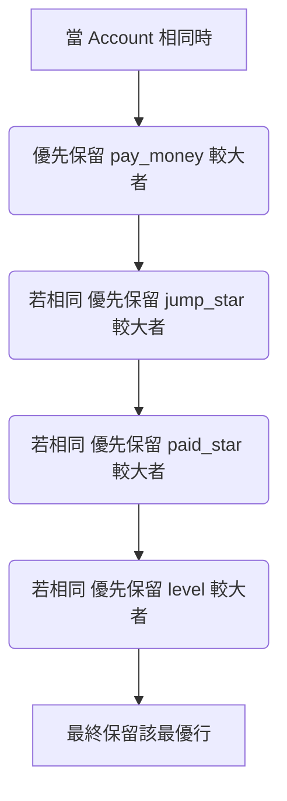

# 📊 JUMP TC 歷史玩家數據清洗報告 (Historical Player Profile Cleaning Report)

本報告記錄了對 JUMP TC 原始合併數據的兩輪核心清洗流程：**帳號去重**與**無效創角帳號剔除**。清洗產物已輸出為最終的乾淨寬表數據。

---

## 🔍 原始數據特徵與來源

* **原始數據源**：`output2_merged_早期重复记录版.csv`
* **原始總行數**：**3,062,485 行** (含表頭)
* **數據欄位**：包含 `account`, `pay_money`, `register_time`, `login_day`, `level`, `playerId`, `playerName`, `heroList`, `jump_star`, `paid_star`, `free_amount`, `paid_amount` 共 12 個維度。

---

## 🛠️ 第一輪清洗：多屬性帳號去重 (Deduplication)

### 1. 去重排序優先級規則

在多個快照數據合併的過程中，部分 `account` 出現了重複登錄或不同快照數值重疊的情形。當 `account` 相同時，我們嚴格按照以下**降序優先級**保留最優、最完整的快照記錄：

### 2. 去重結果統計

* **掃描原始行數**：3,062,484 行 (不含表頭)
* **去重後唯一帳號數**：**3,045,043 行**
* **清除重複行數**：**17,441 行**
* **輸出檔案**：`ja_tc_moba_profile.csv`

> [!NOTE]
> **重複數據特徵分析**：
>
> 1. **完全重疊行**：大量重複行屬於完全一樣的拷貝（在不同合併快照中被重複寫入）。
> 2. **指標數值差異**：少數重複行在 `jump_star` (星鑽) 或 `paid_star` 上存在細微差別，代表玩家在不同快照點的變化狀態，本清洗程序已成功保留了最具代表性（數值最大）的行。

---

## 🧹 第二輪清洗：剔除無創角帳號 (Invalid Account Filtering)

### 1. 過濾規則

部分註冊帳號因「註冊後未進入遊戲創角」、「僅在創角界面流失」等原因，導致其沒有生成有效的 `playerId`。

* **過濾條件**：刪除 `playerId` 欄位為 **空字串 `""`** 或 顯示為 **`"null"`** 的無效記錄。

### 2. 過濾數據特徵

經深度掃描，這類無創角帳號具有極高的特徵一致性：

* **角色等級 (`level`)**：全部為 `0`。
* **角色暱稱 (`playerName`)**：全部為空。
* **擁有英雄 (`heroList`)**：全部為空.
* **登入天數 (`login_day`)**：極低（大多為 `1` 或 `2` 天）。
* **儲值金額 (`pay_money`)**：均為 `0.0`。

### 3. 過濾結果統計

* **掃描輸入行數**：3,045,043 行
* **刪除無效帳號數**：**122,188 行**
* **保留有效角色數**：**2,922,855 行**
* **輸出檔案**：`ja_tc_moba_profile_v2.csv`

> [!IMPORTANT]
> 此步驟移除了約 **4.01%** 的無效註冊帳號，使數據集完全由「擁有真實遊戲角色 ID」的玩家組成，大大提升了下游進行付費分析、留存分析以及活躍度評估的精準度。

---

## 💎 第三輪清洗：儲值金額重構與計算 (Payment Amount Reconstruction - v3)

> [!IMPORTANT]
> **重要說明**：**v3 與 v2 是兩條完全獨立的清洗管線**。
> v3 依然直接基於第一輪帳號去重後的 **`ja_tc_moba_profile.csv`（3,045,043 行）** 進行處理，**沒有**執行「第二輪剔除無效創角（即 `playerId` 為 null）」的過濾操作。因此它保留了全部去重帳號，僅對其進行儲值金額重構。

### 1. 轉換與重構規則

為了精準還原或對齊玩家儲值的真實代幣或鑽石價值，我們對所有儲值用戶的儲值欄位 `pay_money` 進行了如下重構處理：

* **清洗公式**：`pay_money = math.ceil(pay_money * 4.5) * 2`
* **處理邏輯**：將 `pay_money` 乘以 `4.5`，向上取整後，再乘以 `2`。
* **資料特性驗證**：例如，原始付費金額 `7.2524` 經此公式轉換後精準還原為 `66.0`，完全契合玩家的儲值價值鏈條。

### 2. 清洗與處理結果

* **處理總行數**：**3,045,043 行**
* **輸出檔案**：`ja_tc_moba_profile_v3.csv`

---

## 📈 清洗流程全景匯總

| 清洗階段 / 管線分支              | 輸入數據源 | 處置操作                                                | 輸出檔案                                | 剩餘有效行數 (不含表頭) | 清減行數 / 變更規模   | 比例 / 影響   |
| :------------------------------- | :--------- | :------------------------------------------------------ | :-------------------------------------- | :---------------------- | :-------------------- | :------------ |
| **0. 原始未清洗**          | -          | -                                                       | `output2_merged_早期重复记录版.csv`   | 3,062,484               | -                     | -             |
| **1. 帳號去重 (基線)**     | 原始數據   | 降序優先級排序去重                                      | `ja_tc_moba_profile.csv`              | 3,045,043               | 17,441                | 0.57%         |
| **2. 剔除無創角分支 (v2)** | 帳號去重版 | 刪除 `playerId` 缺失行                                | `ja_tc_moba_profile_v2.csv`           | 2,922,855               | 122,188               | 4.01%         |
| **3. 付費重構分支 (v3)**   | 帳號去重版 | `pay_money * 4.5` 向上取整後 `* 2 （转化成跃之星）` | **`ja_tc_moba_profile_v3.csv`** | **3,045,043**     | 全量數值重構 (無剔除) | 100% 儲值重構 |

---

> [!TIP]
> **後續建議**：
>
> * **若需要「無空值角色帳號」的分析數據**，請使用 `ja_tc_moba_profile_v2.csv`（2,922,855 行）。
> * **若需要「包含全量去重帳號且儲值金額重構」的分析數據**，請使用 `ja_tc_moba_profile_v3.csv`（3,045,043 行）。
